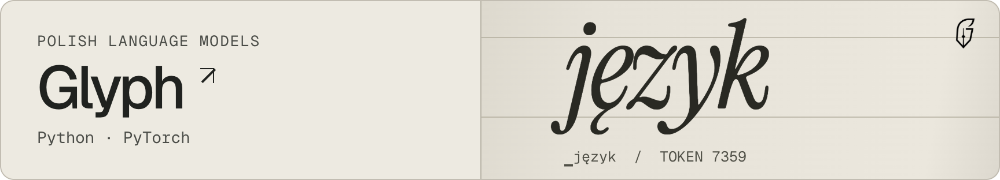
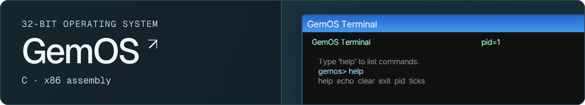

  <a href="https://mksp.dev/">
    <picture>
      <source media="(max-width: 680px), (min-width: 768px) and (max-width: 1020px)" srcset="./assets/profile-mobile.webp">
      
    </picture>
  </a>

## Selected projects

<h3>
  <a href="https://github.com/Maksu2/glyph">
    <picture>
      <source media="(max-width: 680px), (min-width: 768px) and (max-width: 1020px)" srcset="./assets/glyph-mobile.webp">
      
    </picture>
  </a>
</h3>

I trained **Glyph-27M** from scratch for 200,000 steps on an 8 GB Radeon RX 5500 XT. [Model&nbsp;card&nbsp;→](https://github.com/Maksu2/glyph/blob/master/MODEL_CARD.md)

<h3>
  <a href="https://github.com/Maksu2/GemOS">
    <picture>
      <source media="(max-width: 680px), (min-width: 768px) and (max-width: 1020px)" srcset="./assets/gemos-mobile.webp">
      
    </picture>
  </a>
</h3>

I wrote **GemOS** from the bootloader to the desktop. Its text editor runs in user space and saves files to GemFS. [Architecture&nbsp;→](https://github.com/Maksu2/GemOS#current-architecture)

---

**Areas of interest**  
Artificial intelligence · Low-level systems · Embedded electronics · Robotics and automation
