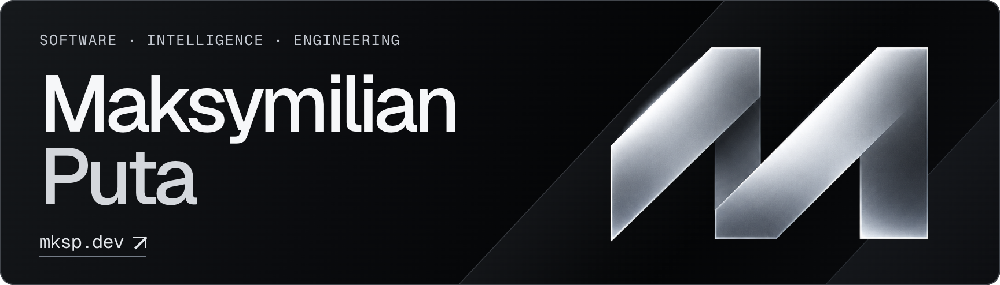
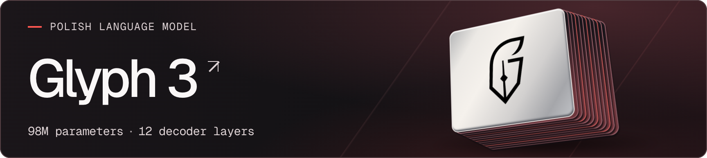
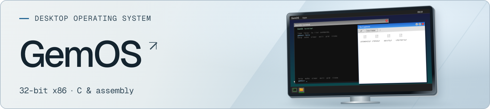

  <a href="https://mksp.dev/">
    <picture>
      <source media="(max-width: 680px), (min-width: 768px) and (max-width: 1020px)" srcset="./assets/profile-mobile.webp">
      
    </picture>
  </a>

## Selected projects

<h3>
  <a href="https://github.com/Maksu2/glyph">
    <picture>
      <source media="(max-width: 680px), (min-width: 768px) and (max-width: 1020px)" srcset="./assets/glyph-3-mobile.webp">
      
    </picture>
  </a>
</h3>

I wrote the Transformer in PyTorch and tuned the training loop to fit an 8 GB Radeon. **Glyph 3** processed 1.76 billion tokens of Polish text during pretraining. I then fine-tuned it to answer short questions. The public chat runs on a CPU in my homelab.

[Try&nbsp;Glyph&nbsp;3&nbsp;→](https://glyph.maksu.online/chat) &nbsp;·&nbsp; [Training&nbsp;notes](https://glyph.maksu.online/#trening)

<h3>
  <a href="https://github.com/Maksu2/GemOS">
    <picture>
      <source media="(max-width: 680px), (min-width: 768px) and (max-width: 1020px)" srcset="./assets/gemos-desktop-mobile.webp">
      
    </picture>
  </a>
</h3>

My two-stage bootloader starts the **GemOS** kernel, which brings up the desktop and runs applications in separate address spaces. I built GemFS to give those applications persistent storage. With a disk attached, you can save a document in the editor, reboot, and reopen it from File Explorer.

[Boot&nbsp;GemOS&nbsp;→](https://gemos.maksu.online/preview/) &nbsp;·&nbsp; [Screenshot](https://github.com/Maksu2/Maksu2/blob/main/assets/gemos-screen.png) &nbsp;·&nbsp; [Architecture](https://github.com/Maksu2/GemOS#current-architecture)

---

**Areas of interest**  
Artificial intelligence · Low-level systems · Embedded electronics · Robotics and automation
